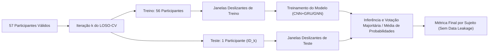

# Relatório Técnico de Inspeção e Auditoria do Dataset Cilia et al. (2022)

> **Projeto:** Triagem e Detecção de Transtorno do Espectro Autista (TEA) via Eye-Tracking e Deep Learning  
> **Metodologia de Validação:** Leave-One-Subject-Out Cross-Validation (LOSO-CV estrito)  
> **Data de Execução:** 15/10/2026 15:00:53  
> **Origem dos Dados:** `data/Metadata_Participants.csv` e 25 gravações em `data/Eye-tracking Output/`  

---

## 1. Auditoria dos Participantes e Metadados

O arquivo `Metadata_Participants.csv` lista originalmente **59 participantes recrutados** (IDs de `1` a `59`).
Ao cruzar esses registros com as gravações temporais dos 25 arquivos de eye-tracking:

- **Participantes Efetivamente Válidos:** **57 participantes** possuem séries temporais válidas.
- **Participantes Ausentes/Vazios:** **2 participantes** (`12`, `16`) não possuem nenhuma linha gravada.

### 1.1 Mapeamento dos Sujeitos Ausentes
Estes participantes constam na ficha clínica, mas não possuem sessões de eye-tracking registradas no experimento:

| ParticipantID | Diagnóstico (Class) | Gênero | Idade (anos) | CARS Score | Motivo / Diagnóstico no Pipeline |
| :---: | :---: | :---: | :---: | :---: | :--- |
| **12** | ASD | M | 11.6 | 36.5 | Ausência total de arquivos de gravação temporal (0 linhas). Falha/recusa na calibração do SMI. |
| **16** | ASD | M | 8.6 | 38.0 | Ausência total de arquivos de gravação temporal (0 linhas). Falha/recusa na calibração do SMI. |

> [!IMPORTANT]
> **Ação Obrigatória:** Os participantes **12** e **16** devem ser defensivamente descartados do pipeline de modelagem e validação cruzada. Manter esses IDs com tensores vazios corromperia o treinamento e o cálculo de métricas em LOSO-CV.

### 1.2 Balanceamento de Classes (57 Participantes Válidos)
Considerando estritamente os **57 participantes com dados temporais reais**, o balanceamento clínico e demográfico é o seguinte:

| Grupo Clínico | Descrição | N Válidos | Proporção (%) | Masculino (M) | Feminino (F) | Idade Média ± DP (anos) | CARS Médio ± DP |
| :--- | :--- | :---: | :---: | :---: | :---: | :---: | :---: |
| **ASD** | Transtorno do Espectro Autista | **27** | 47.37% | 23 | 4 | 7.56 ± 2.72 | 32.65 ± 6.68 |
| **TD** | Desenvolvimento Típico (Controle) | **30** | 52.63% | 13 | 17 | 8.02 ± 2.89 | *N/A* (Não aplicável) |
| **TOTAL** | Base Completa Válida | **57** | **100.00%** | **36** | **21** | **7.81 ± 2.79** | — |

> [!NOTE]
> **Equilíbrio de Classes Quase Perfeito:** A base possui **27 sujeitos TEA (47,4%)** e **30 sujeitos Controle (52,6%)**. Não há necessidade de técnicas artificiais severas de reamostragem (como SMOTE desbalanceado), bastando o uso de `pos_weight` ou `CrossEntropyLoss(weight=...)` balanceado nas funções de custo em PyTorch.

---
## 2. Diagnóstico dos Arquivos Temporais de Eye-Tracking

Os dados de rastreamento ocular estão distribuídos em **25 arquivos CSV** (`1.csv` a `25.csv`).
Cada arquivo representa uma **tarefa/estímulo visual específico** (vídeos `.avi` de interação social, faces humanas, balões em movimento ou imagens estáticas `.jpg`/`.png`).

### 2.1 Visão Geral do Volume e Colunas
- **Volume Bruto Total de Linhas:** 2,252,943 linhas em disco.
- **Linhas de Participantes Válidos:** 1,351,157 linhas (60.0% do total).
- **Linhas 'Unidentified(Neg)' / 'Unidentified(Pos)':** 901,786 linhas (40.0%). São artefatos de calibração ou desvio completo do olhar que o hardware descartou.
- **Total de Colunas Distintas Identificadas:** 59 colunas.
- **Colunas Comuns a 100% dos 25 Arquivos:** **26 colunas**.

### 2.2 Colunas Comuns (Consistentes em Todos os 25 Arquivos)
Estas 26 colunas formam a espinha dorsal garantida para o pipeline de extração de atributos:

`Annotation Description`, `Annotation Name`, `Annotation Tags`, `Category Group`, `Category Right`, `Color`, `Content`, `Export End Trial Time [ms]`, `Export Start Trial Time [ms]`, `Gaze Vector Right X`, `Gaze Vector Right Y`, `Gaze Vector Right Z`, `Index Right`, `Mouse Position X [px]`, `Mouse Position Y [px]`, `Participant`, `Point of Regard Right X [px]`, `Point of Regard Right Y [px]`, `RecordingTime [ms]`, `Scroll Direction X`, `Scroll Direction Y`, `Stimulus`, `Time of Day [h:m:s:ms]`, `Tracking Ratio [%]`, `Trial`

### 2.3 Colunas Variantes e Inconsistências de Hardware
- **Gravação Monocular vs. Binocular:** Arquivos como `8.csv` e `13.csv` foram exportados apenas com o olho direito (`Right`), enquanto os outros 23 arquivos possuem ambos (`Right` e `Left`).
- **Diâmetro Pupilar (`Pupil Diameter Right [mm]`):** Presente em 19 dos 25 arquivos. Ausente em 6 arquivos (`6.csv`, `8.csv`, `10.csv`, `13.csv`, `16.csv`, `25.csv`).
- **Vetor de Olhar (`Gaze Vector Right X, Y, Z`):** Presente em todos os 25 arquivos (coordenadas tridimensionais normalizadas da direção do olhar).

### 2.4 Frequência de Amostragem e Estabilidade Temporal ($dt$)
- **Intervalo Mediano:** **19.88 ms** ($\approx$ **50.3 Hz**).
- **Intervalo Médio:** **24.05 ms** (desvio padrão de jitter temporal).
- **Percentil 5% a 95%:** de **16.69 ms** a **44.08 ms**.
O rastreador (SMI RED) opera nominalmente a **50 Hz** (período de 20 ms). Pequenas flutuações e 'drops' temporais ocorrem devido ao buffer USB e pausas de renderização gráfica.

### 2.5 Taxa de Perda de Sinal: TEA vs. Neurotípicos
Diferença brutal e clinicamente significativa na qualidade do rastreamento entre os grupos:

| Métrica de Rastreamento | Grupo ASD (TEA) | Grupo TD (Controle) | Interpretação Clínica & Engenharia |
| :--- | :---: | :---: | :--- |
| **Taxa Média de Rastreamento (SMI Tracking Ratio)** | **60.10%** ± 25.21% | **84.83%** ± 12.39% | Crianças neurotípicas mantêm foco na tela quase 85% do tempo. |
| **Taxa Média de Perda de Sinal (Loss Ratio)** | **39.90%** | **15.17%** | Crianças TEA perdem o rastreio ~40% do tempo (aversão ao olhar, hiperatividade). |
| **Média de Linhas Válidas por Sujeito** | **18,274** linhas | **28,592** linhas | Séries temporais de TEA são mais curtas ou mais fragmentadas por blinks. |
| **Média de Estímulos Concluídos (de 25)** | **6.4** estímulos | **7.8** estímulos | Menor tolerância a protocolos longos no grupo clínico. |

---
## 3. Resumo Individual dos 57 Participantes Válidos

A tabela abaixo sintetiza a quantidade de dados, estímulos assistidos e a perda média de sinal para cada um dos 57 participantes válidos:

| ID | Classe | Gênero | Idade | Total Linhas | Estímulos | SMI Tracking (%) | Perda Sinal (%) | Blinks | Coords (0,0) | Status |
| :---: | :---: | :---: | :---: | :---: | :---: | :---: | :---: | :---: | :---: | :--- |
| 1 | ASD | M | 7.0 | 8,531 | 4/25 | 92.7% | 7.3% | 851 | 1,322 | OK |
| 2 | ASD | F | 8.9 | 7,132 | 4/25 | 51.2% | 48.8% | 1,458 | 2,193 | OK |
| 3 | ASD | M | 4.4 | 8,865 | 4/25 | 85.4% | 14.6% | 621 | 618 | OK |
| 4 | ASD | M | 6.9 | 9,165 | 4/25 | 91.9% | 8.1% | 501 | 868 | OK |
| 5 | ASD | M | 8.9 | 8,449 | 4/25 | 67.9% | 32.1% | 1,059 | 1,059 | OK |
| 6 | ASD | M | 4.7 | 8,339 | 4/25 | 90.9% | 9.1% | 601 | 1,072 | OK |
| 7 | ASD | M | 9.3 | 6,187 | 4/25 | 38.2% | 61.8% | 2,370 | 2,750 | OK |
| 8 | ASD | F | 12.3 | 6,265 | 4/25 | 38.9% | 61.1% | 2,248 | 3,170 | OK |
| 9 | ASD | M | 2.7 | 7,658 | 4/25 | 36.5% | 63.5% | 3,741 | 4,745 | OK |
| 10 | ASD | M | 9.5 | 9,289 | 4/25 | 93.7% | 6.3% | 423 | 462 | OK |
| 11 | ASD | M | 7.5 | 16,297 | 7/25 | 63.2% | 36.8% | 4,109 | 4,671 | OK |
| 13 | ASD | M | 5.4 | 13,231 | 6/25 | 70.3% | 29.7% | 1,819 | 1,812 | OK |
| 14 | ASD | M | 8.0 | 13,087 | 6/25 | 70.4% | 29.6% | 1,517 | 1,443 | OK |
| 15 | ASD | M | 9.4 | 19,503 | 8/25 | 41.4% | 58.6% | 4,710 | 5,664 | OK |
| 17 | ASD | M | 10.6 | 43,963 | 10/25 | 15.7% | 84.3% | 17,141 | 25,558 | OK |
| 18 | ASD | M | 11.7 | 32,940 | 10/25 | 53.0% | 47.0% | 8,054 | 10,157 | OK |
| 19 | ASD | M | 10.9 | 34,307 | 10/25 | 76.2% | 23.8% | 3,813 | 4,814 | OK |
| 20 | ASD | M | 10.1 | 34,502 | 10/25 | 72.5% | 27.5% | 4,521 | 5,359 | OK |
| 21 | ASD | M | 6.9 | 24,316 | 10/25 | 28.6% | 71.4% | 12,860 | 17,325 | OK |
| 22 | ASD | M | 7.1 | 18,517 | 4/25 | 95.9% | 4.1% | 1,479 | 2,088 | OK |
| 23 | ASD | M | 3.2 | 21,750 | 9/25 | 48.1% | 51.9% | 5,061 | 7,463 | OK |
| 24 | ASD | F | 6.5 | 36,853 | 5/25 | 80.2% | 19.8% | 9,351 | 12,129 | OK |
| 25 | ASD | M | 5.8 | 17,812 | 6/25 | 73.9% | 26.1% | 4,985 | 5,273 | OK |
| 26 | ASD | M | 4.9 | 17,768 | 6/25 | 70.7% | 29.3% | 4,989 | 5,214 | OK |
| 27 | ASD | F | 5.6 | 19,413 | 9/25 | 12.7% | 87.3% | 9,906 | 12,790 | OK |
| 28 | ASD | M | 11.8 | 16,444 | 8/25 | 24.4% | 75.5% | 7,052 | 9,503 | OK |
| 29 | ASD | M | 4.2 | 32,807 | 9/25 | 38.6% | 61.4% | 20,194 | 22,791 | OK |
| 30 | TD | F | 6.7 | 46,085 | 15/25 | 86.9% | 13.1% | 4,262 | 4,863 | OK |
| 31 | TD | F | 8.8 | 41,023 | 13/25 | 82.3% | 17.6% | 5,875 | 6,479 | OK |
| 32 | TD | M | 5.8 | 11,233 | 5/25 | 89.7% | 10.3% | 594 | 717 | OK |
| 33 | TD | F | 5.8 | 13,114 | 6/25 | 80.9% | 19.1% | 575 | 474 | OK |
| 34 | TD | M | 8.1 | 9,769 | 4/25 | 98.8% | 1.2% | 263 | 279 | OK |
| 35 | TD | M | 4.2 | 11,473 | 5/25 | 94.0% | 6.0% | 364 | 491 | OK |
| 36 | TD | F | 8.9 | 38,571 | 12/25 | 90.0% | 10.0% | 2,547 | 2,603 | OK |
| 37 | TD | F | 12.8 | 22,029 | 7/25 | 86.9% | 13.1% | 514 | 685 | OK |
| 38 | TD | M | 3.7 | 10,202 | 5/25 | 64.8% | 35.2% | 1,228 | 1,443 | OK |
| 39 | TD | M | 8.6 | 14,034 | 6/25 | 92.5% | 7.5% | 249 | 319 | OK |
| 40 | TD | F | 8.2 | 12,077 | 5/25 | 97.3% | 2.7% | 126 | 122 | OK |
| 41 | TD | F | 8.0 | 7,913 | 1/25 | 99.0% | 1.0% | 41 | 253 | OK |
| 42 | TD | F | 4.2 | 20,094 | 9/25 | 37.8% | 62.2% | 6,839 | 8,440 | OK |
| 43 | TD | M | 8.1 | 21,904 | 6/25 | 83.3% | 16.7% | 4,242 | 7,802 | OK |
| 44 | TD | M | 12.9 | 16,102 | 6/25 | 91.9% | 8.1% | 105 | 316 | OK |
| 45 | TD | M | 5.7 | 14,599 | 6/25 | 75.1% | 24.9% | 438 | 422 | OK |
| 46 | TD | F | 9.1 | 24,675 | 6/25 | 83.1% | 16.9% | 584 | 732 | OK |
| 47 | TD | F | 8.2 | 18,762 | 6/25 | 93.7% | 6.3% | 345 | 349 | OK |
| 48 | TD | F | 11.0 | 15,146 | 6/25 | 82.4% | 17.6% | 874 | 836 | OK |
| 49 | TD | F | 12.3 | 58,822 | 16/25 | 83.7% | 16.3% | 7,202 | 8,496 | OK |
| 50 | TD | F | 11.5 | 32,264 | 10/25 | 87.6% | 12.4% | 275 | 437 | OK |
| 51 | TD | F | 10.7 | 16,185 | 6/25 | 89.9% | 10.1% | 509 | 543 | OK |
| 52 | TD | M | 10.7 | 61,552 | 15/25 | 72.8% | 27.2% | 10,811 | 13,669 | OK |
| 53 | TD | M | 6.8 | 43,409 | 8/25 | 92.4% | 7.6% | 4,636 | 5,933 | OK |
| 54 | TD | M | 3.7 | 82,001 | 9/25 | 86.1% | 13.9% | 13,834 | 21,091 | OK |
| 55 | TD | F | 6.5 | 21,871 | 6/25 | 64.9% | 35.1% | 2,000 | 1,931 | OK |
| 56 | TD | M | 4.7 | 51,845 | 9/25 | 87.4% | 12.6% | 6,191 | 7,266 | OK |
| 57 | TD | M | 8.6 | 27,581 | 7/25 | 98.4% | 1.6% | 657 | 667 | OK |
| 58 | TD | F | 12.7 | 48,350 | 9/25 | 86.5% | 13.5% | 4,572 | 5,346 | OK |
| 59 | TD | F | 3.7 | 45,082 | 9/25 | 84.7% | 15.3% | 8,718 | 9,053 | OK |

---
## 4. Recomendações Estratégicas para o Pipeline PyTorch e DataLoader

### 4.1 Tratamento dos Sujeitos Ausentes (IDs 12 e 16)
1. **Descarte Imediato no Mapeamento:** Excluir os IDs `12` e `16` na lista de índices do `Dataset` do PyTorch.
2. **Fundamentação Metodológica:** Não se trata de descarte por conveniência (viés de seleção), mas de **dados ausentes estruturais** (*Missing Completely at Random* decorrente de falha de calibração pré-teste). Manter esses participantes forçaria imputações artificiais sem qualquer sinal empírico, enviesando o LOSO-CV.

### 4.2 Tratamento de Ruído, Blinks e Coordenadas (0, 0)
1. **Normalização Espacial:** O SMI RED opera com resolução nativa de **1280 x 1024 px**.
   - Normalizar coordenadas para a faixa $[0, 1]$ dividindo $X$ por $1280$ e $Y$ por $1024$.
   - Valores $< 0$ ou $> 1$ ligeiramente fora da tela (até 10%) devem ser recortados (*clipped*) para $[0, 1]$.
2. **Substituição de Zeros Anômalos por NaN:** Coordenadas com $X = 0$ e $Y = 0$ sincronizadas com perda pupilar não representam o canto superior esquerdo da tela; são códigos de hardware para ausência de sinal. Devem ser convertidas explicitamente para `NaN`.
3. **Interpolação Linear Seletiva (Regra dos 150 ms):**
   - **Gaps Curtos ($\le 150$ ms / $\le 8$ timesteps consecutivos a 50 Hz):** Representam piscadas fisiológicas normais (*blinks*). Devem ser imputados via **interpolação linear simples** em $X$ e $Y$.
   - **Gaps Longos ($> 150$ ms):** Representam perda real de engajamento, rotação da cabeça ou olhar fora da tela. **NÃO devem ser interpolados linearmente**, pois isso inventaria trajetórias sacádicas irreais cruzando a tela. Devem ser tratados como quebras de segmento ou marcados explicitamente com **vetor de máscara binária de validade** (`valid_mask = 0`).

### 4.3 Estratégia de Segmentação Temporal (Janelamento Deslizante)
Como os estímulos variam de 48 a 160 segundos e cada participante possui número diferente de estímulos:
1. **Janelas Deslizantes Fixas (*Sliding Windows*):**
   - Tamanho da janela: $T = 250$ passos ($\approx 5$ segundos a 50 Hz) ou $T = 500$ passos ($\approx 10$ segundos).
   - Sobreposição (*overlap* / stride): 50% para aumento de amostras de treino.
   - Descarte de janelas com perda de sinal superior a 50% (`valid_ratio < 0.50`).
2. **Padronização para Tensores do PyTorch:**
   - Tensor de entrada: $(B, T, C)$ onde $C$ inclui: $[x, y, v_x, v_y, v, a, \text{pupil}, \text{is\_fixation}, \text{is\_saccade}]$.
   - Máscara de Atenção / Padding: `torch.nn.utils.rnn.pack_padded_sequence` ou uso de máscara binária booleana `mask: (B, T)` para evitar que o modelo aprenda sobre os trechos nulos.

### 4.4 Garantia de Não-Vazamento (LOSO-CV Estrito)

> [!CAUTION]
> **Regra de Ouro da Normalização:** Qualquer escalonamento (StandardScaler / MinMax) deve ser ajustado **apenas nas janelas do conjunto de treino (56 sujeitos)** e aplicado no sujeito de teste (1 sujeito). Nunca normalize o dataset global antes da partição do LOSO!

---
## 5. Próximos Passos Recomendados para Modelagem
1. **Baseline Tabular/Estatístico:** Extrair métricas agregadas por participante (duração média de fixações, velocidade sacádica média, taxa de blinks, entropia espacial) e rodar um classificador LightGBM/RandomForest como baseline.
2. **Engenharia de Features Cinemáticas:** Implementar derivadas temporais discretas ($v_t = \frac{\Delta p}{\Delta t}$, $a_t = \frac{\Delta v}{\Delta t}$).
3. **Pipeline PyTorch DataLoader:** Criar `CiliaEyeDataset(torch.utils.data.Dataset)` com suporte a janelamento, interpolação de gaps curtos e retorno de máscara de atenções.
4. **Modelos Neurais Sequenciais:** Treinar arquiteturas 1D-CNN + BiGRU e avaliar acurácia balanceada, sensibilidade e especificidade por sujeito em LOSO-CV.
